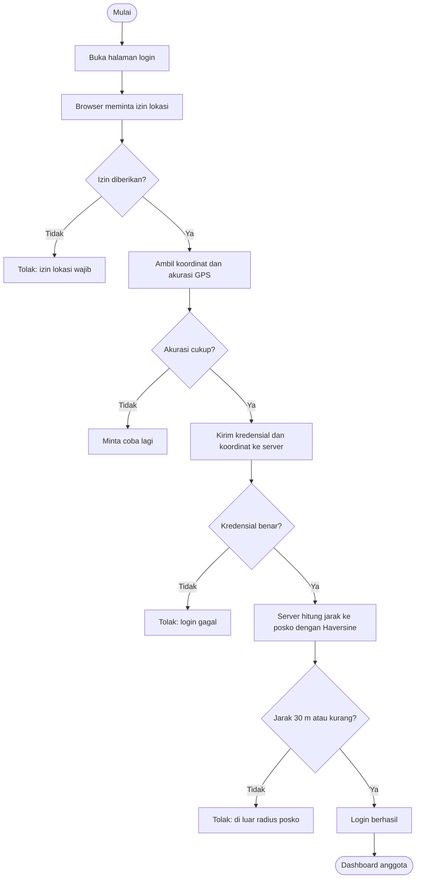
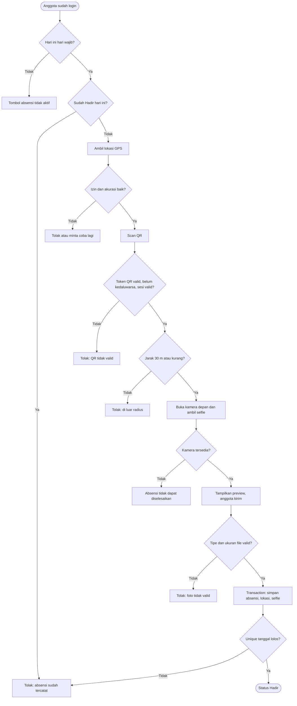
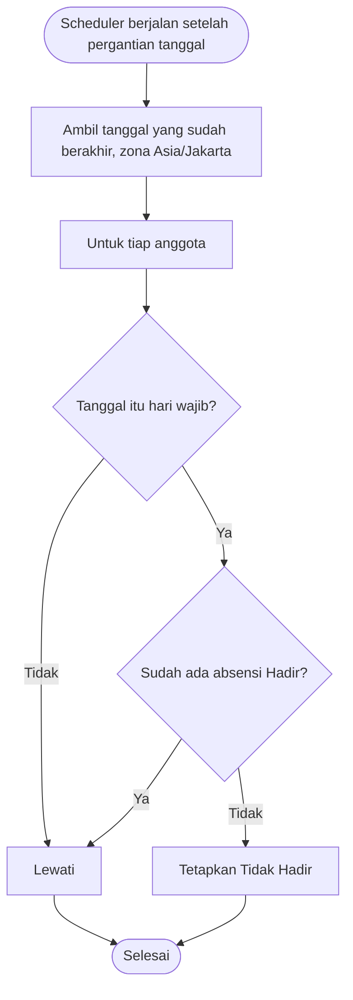
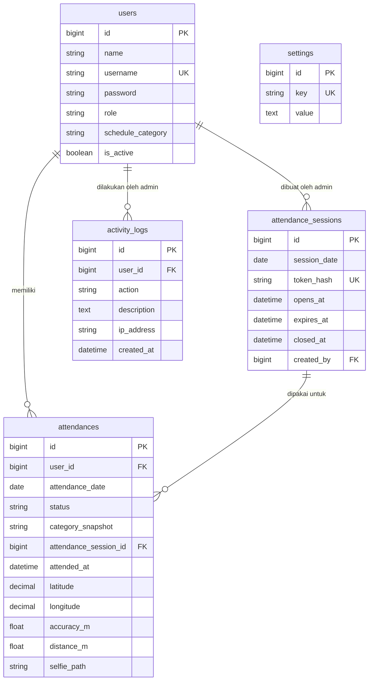

# PROJECT MASTER DOCUMENT

## KKN MANAGEMENT SYSTEM

Terakhir diperbarui: 2026-11-06

## 1. Identitas Proyek

- Nama aplikasi: KKN MANAGEMENT SYSTEM
- Modul pertama: Sistem Absensi Digital KKN Kelompok 30 UNTARA
- Developer dan administrator utama: Muhamad Rahel Alvizahri
- Lokasi kegiatan: Kelurahan Kadu Agung, Kecamatan Tigaraksa, Kabupaten Tangerang, Provinsi Banten
- Jumlah anggota: 18 orang

## 2. Tujuan

Membangun sistem informasi berbasis web untuk membantu pengelolaan kegiatan KKN secara terpusat, terstruktur, transparan, dan mudah digunakan. Dapat diakses melalui laptop, Android, dan iOS (browser), dengan desain responsif yang mengutamakan smartphone.

## 3. Ruang Lingkup

- Tahap pertama: Modul 1 Sistem Absensi Digital.
- Modul lain (administrasi, data anggota, monitoring program kerja, dokumentasi, dashboard, chatbot) direncanakan setelah modul absensi stabil.
- KARAKSA WASTE adalah aplikasi terpisah dan tidak dicampur ke modul absensi.

## 4. Teknologi (versi diperiksa lewat perintah terminal pada 2026-11-06)

| Komponen          | Versi                                    |
| ----------------- | ---------------------------------------- |
| Sistem operasi    | Windows                                  |
| Local development | Laragon                                  |
| Editor            | Visual Studio Code                       |
| Laravel           | 13.40.0                                  |
| PHP               | 8.5.8                                    |
| Composer          | 2.10.3                                   |
| Node.js           | 22.23.1                                  |
| NPM               | 10.9.8                                   |
| Database          | MySQL 8.0.30                             |
| Frontend          | Belum ditentukan (diputuskan di Phase 2) |

- Folder proyek: C:\laragon\www\kkn-management-system
- Database: kkn_management_system
- Repository: https://github.com/elrafdinata/kkn-management-system
- Branch: main
- Commit terakhir saat audit: d5833e4 (Initial project setup)

## 5. Aturan Bisnis (ditetapkan pemilik proyek)

**Role**

- Administrator: login dari mana saja, tanpa batas geofence, akses penuh.
- Anggota: login hanya dalam radius posko, hanya melihat data sendiri.
- Pembatasan akses diterapkan di backend.

**Geofencing**

- Radius 30 meter dari titik posko, dihitung dengan Haversine di backend.
- Divalidasi saat login, absensi, dan pemrosesan QR.
- Koordinat posko disimpan di pengaturan database, bukan di kode.
- Koordinat posko: BELUM DIBERIKAN.

**Kategori jadwal**

- Stay: wajib absensi Senin-Minggu.
- Shift Malam: wajib absensi Senin-Minggu.
- Weekend: wajib absensi Sabtu-Minggu.
- Hari tidak wajib tidak dihitung Tidak Hadir.

**Waktu**

- Zona waktu Asia/Jakarta, absensi 00.00-23.59 WIB.
- Satu absensi berhasil per anggota per hari.
- Tidak ada status Terlambat dan tidak ada absensi pagi/sore.

**Status absensi**: Hadir, Menunggu, Tidak Hadir (Tidak Hadir ditetapkan otomatis oleh Scheduler setelah hari berakhir).

**QR Code**: token acak, ada masa berlaku, diverifikasi server, tidak bisa dipakai ulang. Durasi kedaluwarsa: BELUM DITENTUKAN.

**Selfie**: wajib dari kamera langsung, disimpan di storage privat, anggota hanya melihat foto sendiri. Tidak ada face recognition.

## 6. Keputusan yang Belum Ditentukan

- Koordinat posko (dibutuhkan di Phase 5).
- Durasi kedaluwarsa QR Code (dibutuhkan di Phase 7).
- Pilihan frontend (dibutuhkan di Phase 2).

## 7. Catatan Keamanan

Repository bersifat public. Dilarang mengunggah password, token, isi .env, koordinat posko sensitif, atau data pribadi anggota.

## 8. Status Dokumen

- Dokumen ini dibuat pada Phase 0.
- Status Git per 2026-11-06: folder docs/ belum di-commit (Untracked).
- Tinjauan dokumentasi: 7 dari 7 dokumen sudah ditinjau, koreksi sedang diterapkan.
- Belum ada fitur absensi yang dibuat atau diuji.

# DEVELOPMENT ROADMAP

## KKN MANAGEMENT SYSTEM - Modul 1 Sistem Absensi

Terakhir diperbarui: 2026-11-06

Tingkat status: Direncanakan, Dibuat, Dijalankan, Diuji, Berhasil, Siap digunakan.

Aturan: kerjakan berurutan, jangan melewati tahap tanpa persetujuan dan pengujian.

| Phase | Nama                             | Status                     | Catatan                                                                       |
| ----- | -------------------------------- | -------------------------- | ----------------------------------------------------------------------------- |
| 0     | Project Discovery                | Dijalankan (belum lengkap) | Audit berhasil. 7 dokumen dibuat, koreksi sedang diterapkan, belum di-commit. |
| 1     | System Analysis                  | Direncanakan               | SRS, kebutuhan fungsional dan non-fungsional, aktor, hak akses, diagram       |
| 2     | System Design                    | Direncanakan               | Arsitektur, ERD, schema, route, UI/UX, desain alur, pilihan frontend          |
| 3     | Project Foundation               | Direncanakan               | Konfigurasi, timezone, layout, fondasi autentikasi dan role                   |
| 4     | Authentication & User Management | Direncanakan               | Login, logout, kelola anggota, kategori jadwal                                |
| 5     | Geofencing                       | Direncanakan               | Perlu koordinat posko dari pemilik proyek                                     |
| 6     | Schedule Management              | Direncanakan               | Stay, Shift Malam, Weekend                                                    |
| 7     | QR Attendance                    | Direncanakan               | Perlu keputusan durasi kedaluwarsa QR                                         |
| 8     | Selfie Attendance                | Direncanakan               | Kamera, preview, penyimpanan privat                                           |
| 9     | Attendance Status & Automation   | Direncanakan               | Hadir/Menunggu/Tidak Hadir, Scheduler, Cron                                   |
| 10    | Admin Dashboard                  | Direncanakan               | Statistik, anggota, riwayat, filter, pengaturan                               |
| 11    | Member Dashboard                 | Direncanakan               | Status, absensi, jadwal, riwayat, statistik pribadi                           |
| 12    | Reporting                        | Direncanakan               | Rekap dan ekspor Excel dan PDF                                                |
| 13    | Security & Testing               | Direncanakan               | Pengujian fungsional, keamanan, akses, responsivitas                          |
| 14    | Deployment                       | Direncanakan               | Hosting, HTTPS, storage, scheduler, backup, uji 18 akun                       |
| 15    | Release & Documentation          | Direncanakan               | Panduan admin dan anggota, dokumentasi, evaluasi akhir                        |

## Rincian Phase 0

- [x] Proyek Laravel dibuat (terverifikasi audit)
- [x] Koneksi database dan migration bawaan (terverifikasi audit)
- [x] Git dan push awal, commit d5833e4 (terverifikasi audit)
- [x] Audit versi teknologi dan kondisi repository
- [x] Versi MySQL 8.0.30 terverifikasi (2026-11-06)
- [x] PROJECT_MASTER_DOCUMENT.md (dibuat, belum di-commit)
- [x] DEVELOPMENT_ROADMAP.md (dibuat, belum di-commit)
- [x] PROJECT_PROGRESS.md (dibuat, belum di-commit)
- [x] DATABASE_DOCUMENTATION.md (dibuat, belum di-commit)
- [x] SYSTEM_ARCHITECTURE.md (dibuat, belum di-commit)
- [x] CHANGELOG.md (dibuat, belum di-commit)
- [x] NEXT_SESSION_PROMPT.md (dibuat, belum di-commit)
- [x] Tinjauan 7 dokumen selesai (2026-11-06)
- [ ] Koreksi dokumen diterapkan (sedang berjalan)
- [ ] Persetujuan pemilik proyek untuk commit dokumentasi

Kriteria Phase 0 selesai: semua koreksi diterapkan, pemilik proyek menyetujui, commit dan push berhasil, dan git status bersih.

Status Git per 2026-11-06: folder docs/ belum di-commit (Untracked).

## Keputusan yang masih terbuka

- Koordinat posko (dibutuhkan di Phase 5)
- Durasi kedaluwarsa QR Code (dibutuhkan di Phase 7)
- Pilihan frontend (dibutuhkan di Phase 2)

# DATABASE DOCUMENTATION

## KKN MANAGEMENT SYSTEM - Modul 1 Sistem Absensi

Terakhir diperbarui: 2026-11-06
Status Git dokumen ini: Untracked (belum di-commit).

## Status Verifikasi

- Terverifikasi lewat `php artisan db:table`: tabel `sessions` (InnoDB, utf8mb4_unicode_ci).
- Terverifikasi lewat `php artisan migrate:status` pada 2026-11-06: 3 migration bawaan berstatus Ran.
- Tabel lain: struktur dicatat dari hasil query `information_schema` sebelumnya dan belum diperiksa ulang satu per satu.
- Foreign key: belum diverifikasi.

## Informasi Umum

- Database: kkn_management_system
- DBMS: MySQL 8.0.30
- Server MySQL lokal dipakai bersama proyek lain. Jangan mengubah database selain kkn_management_system.
- Perintah destruktif (migrate:fresh, db:wipe, hapus tabel) dilarang tanpa persetujuan pemilik proyek.

## Migration yang Sudah Dijalankan (Batch 1)

| Migration                            | Status |
| ------------------------------------ | ------ |
| 0001_01_01_000000_create_users_table | Ran    |
| 0001_01_01_000001_create_cache_table | Ran    |
| 0001_01_01_000002_create_jobs_table  | Ran    |

## Daftar Tabel (9 tabel bawaan Laravel)

Database kkn_management_system berisi 9 tabel. Angka 76 pada `db:show` adalah jumlah seluruh tabel di server MySQL lokal, bukan tabel proyek ini.

Belum ada tabel buatan sendiri untuk modul absensi.

### users

| Kolom             | Tipe            | Null | Key     |
| ----------------- | --------------- | ---- | ------- |
| id                | bigint unsigned | NO   | PRIMARY |
| name              | varchar(255)    | NO   |         |
| email             | varchar(255)    | NO   | UNIQUE  |
| email_verified_at | timestamp       | YES  |         |
| password          | varchar(255)    | NO   |         |
| remember_token    | varchar(100)    | YES  |         |
| created_at        | timestamp       | YES  |         |
| updated_at        | timestamp       | YES  |         |

Catatan: struktur masih bawaan Laravel. Belum ada kolom role, kategori jadwal, atau status aktif.

### password_reset_tokens

| Kolom      | Tipe         | Null | Key     |
| ---------- | ------------ | ---- | ------- |
| email      | varchar(255) | NO   | PRIMARY |
| token      | varchar(255) | NO   |         |
| created_at | timestamp    | YES  |         |

### sessions

Terverifikasi lewat `db:table`: engine InnoDB, collation utf8mb4_unicode_ci.

| Kolom         | Tipe            | Null | Key     |
| ------------- | --------------- | ---- | ------- |
| id            | varchar(255)    | NO   | PRIMARY |
| user_id       | bigint unsigned | YES  | INDEX   |
| ip_address    | varchar(45)     | YES  |         |
| user_agent    | text            | YES  |         |
| payload       | longtext        | NO   |         |
| last_activity | int             | NO   | INDEX   |

### cache

| Kolom      | Tipe         | Null | Key     |
| ---------- | ------------ | ---- | ------- |
| key        | varchar(255) | NO   | PRIMARY |
| value      | mediumtext   | NO   |         |
| expiration | bigint       | NO   | INDEX   |

### cache_locks

| Kolom      | Tipe         | Null | Key     |
| ---------- | ------------ | ---- | ------- |
| key        | varchar(255) | NO   | PRIMARY |
| owner      | varchar(255) | NO   |         |
| expiration | bigint       | NO   | INDEX   |

### jobs

| Kolom        | Tipe              | Null | Key     |
| ------------ | ----------------- | ---- | ------- |
| id           | bigint unsigned   | NO   | PRIMARY |
| queue        | varchar(255)      | NO   | INDEX   |
| payload      | longtext          | NO   |         |
| attempts     | smallint unsigned | NO   |         |
| reserved_at  | int unsigned      | YES  |         |
| available_at | int unsigned      | NO   |         |
| created_at   | int unsigned      | NO   |         |

### job_batches

| Kolom          | Tipe         | Null | Key     |
| -------------- | ------------ | ---- | ------- |
| id             | varchar(255) | NO   | PRIMARY |
| name           | varchar(255) | NO   |         |
| total_jobs     | int          | NO   |         |
| pending_jobs   | int          | NO   |         |
| failed_jobs    | int          | NO   |         |
| failed_job_ids | longtext     | NO   |         |
| options        | mediumtext   | YES  |         |
| cancelled_at   | int          | YES  |         |
| created_at     | int          | NO   |         |
| finished_at    | int          | YES  |         |

### failed_jobs

| Kolom      | Tipe            | Null | Key                                       |
| ---------- | --------------- | ---- | ----------------------------------------- |
| id         | bigint unsigned | NO   | PRIMARY                                   |
| uuid       | varchar(255)    | NO   | UNIQUE                                    |
| connection | varchar(255)    | NO   | INDEX gabungan                            |
| queue      | varchar(255)    | NO   | INDEX gabungan                            |
| payload    | longtext        | NO   |                                           |
| exception  | longtext        | NO   |                                           |
| failed_at  | timestamp       | NO   | INDEX gabungan, default CURRENT_TIMESTAMP |

### migrations

| Kolom     | Tipe         | Null | Key     |
| --------- | ------------ | ---- | ------- |
| id        | int unsigned | NO   | PRIMARY |
| migration | varchar(255) | NO   |         |
| batch     | int          | NO   |         |

## Index dan Unique Constraint

Dicatat dari hasil query `information_schema` sebelumnya. Belum diperiksa ulang satu per satu.

| Tabel         | Index                                        | Jenis       | Kolom                        |
| ------------- | -------------------------------------------- | ----------- | ---------------------------- |
| cache         | cache_expiration_index                       | Index       | expiration                   |
| cache_locks   | cache_locks_expiration_index                 | Index       | expiration                   |
| failed_jobs   | failed_jobs_uuid_unique                      | Unique      | uuid                         |
| failed_jobs   | failed_jobs_connection_queue_failed_at_index | Index       | connection, queue, failed_at |
| jobs          | jobs_queue_index                             | Index       | queue                        |
| sessions      | sessions_last_activity_index                 | Index       | last_activity                |
| sessions      | sessions_user_id_index                       | Index       | user_id                      |
| users         | users_email_unique                           | Unique      | email                        |
| (semua tabel) | PRIMARY                                      | Primary key | lihat tabel masing-masing    |

## Relasi / Foreign Key

Belum diverifikasi. Query yang dijalankan hanya membaca indeks, bukan foreign key. Akan diperiksa pada tahap berikutnya jika diperlukan.

## Rencana Perubahan Database (Direncanakan, belum dibuat)

Tabel untuk modul absensi akan dirancang pada Phase 2 (System Design), termasuk unique constraint satu anggota satu tanggal, sesuai aturan bisnis. Belum ada perubahan database buatan sendiri.

## Riwayat Perubahan Database

| Tanggal       | Perubahan                             | Status                                |
| ------------- | ------------------------------------- | ------------------------------------- |
| (awal proyek) | 3 migration bawaan Laravel dijalankan | Berhasil, status Ran dicek 2026-11-06 |

# SYSTEM ARCHITECTURE

## KKN MANAGEMENT SYSTEM - Modul 1 Sistem Absensi

Terakhir diperbarui: 2026-11-06
Status Git dokumen ini: Untracked (belum di-commit).

## Status Verifikasi

- Terverifikasi pada 2026-11-06: isi `composer.json` (dibaca langsung) dan versi Laravel 13.40.0 (`php artisan --version`).
- Struktur folder dan route dicatat dari pemeriksaan sebelumnya dan belum diperiksa ulang pada sesi ini.
- Isi `package.json` belum dibaca ulang.

## 1. Gambaran Umum

- Pendekatan: Laravel MVC, satu aplikasi untuk Administrator dan Anggota.
- Prinsip: modular, sederhana untuk tahap awal, dapat ditambah modul baru tanpa membangun ulang.
- Status: baru struktur bawaan Laravel. Belum ada kode buatan sendiri.

## 2. Teknologi

Terverifikasi dari `composer.json`:

- PHP minimal ^8.3 (terpasang 8.5.8)
- laravel/framework ^13.17 (terpasang 13.40.0)
- laravel/tinker ^3.0
- Dev: fakerphp/faker ^1.23, laravel/pail ^1.2.5, laravel/pao ^1.0.6, laravel/pint ^1.27, mockery/mockery ^1.6, nunomaduro/collision ^8.6, phpunit/phpunit ^12.5.12
- Package Composer tambahan: belum ada. Package QR dan ekspor Excel/PDF belum dipasang.

Frontend:

- Pilihan frontend: belum ditentukan (diputuskan di Phase 2).
- Build tool: file `vite.config.js` dan `package.json` ada di proyek. Isinya belum diperiksa ulang.

## 3. Struktur Folder (dicatat dari pemeriksaan sebelumnya)

```
kkn-management-system/
  app/
    Http/Controllers/Controller.php
    Models/User.php
    Providers/AppServiceProvider.php
  bootstrap/        (app.php, providers.php, cache/)
  config/           (app, auth, cache, database, filesystems, logging, mail, queue, services, session)
  database/
    factories/UserFactory.php
    migrations/     (3 migration bawaan)
    seeders/DatabaseSeeder.php
  docs/             (dokumentasi proyek)
  public/
  resources/
    css/app.css
    js/app.js
    views/welcome.blade.php
  routes/           (web.php, console.php)
  storage/
  tests/
  vendor/
  .env              (rahasia, tidak masuk Git)
  .env.example
  composer.json, package.json, vite.config.js, phpunit.xml
  AGENTS.md, CLAUDE.md, README.md
```

## 4. Komponen Aktual

| Komponen     | Kondisi                                      |
| ------------ | -------------------------------------------- |
| Controller   | Hanya Controller dasar bawaan                |
| Model        | Hanya User (bawaan)                          |
| Middleware   | Belum ada buatan sendiri                     |
| Service      | Belum ada (folder app/Services belum dibuat) |
| Form Request | Belum ada                                    |
| View         | Hanya welcome.blade.php                      |
| Seeder       | Hanya DatabaseSeeder bawaan                  |

## 5. Route Aktual (dicatat dari pemeriksaan sebelumnya)

| Method  | URI            | Keterangan                                |
| ------- | -------------- | ----------------------------------------- |
| GET     | /              | Menampilkan view welcome (routes/web.php) |
| GET/PUT | storage/{path} | Bawaan Laravel                            |
| GET     | up             | Health check bawaan Laravel               |

Belum ada route login, dashboard, absensi, atau admin.
Detail method route akan diverifikasi ulang dengan `php artisan route:list`.

## 6. Alur Proses

Belum ada alur proses buatan sendiri. Alur autentikasi, geofencing, QR, dan selfie akan dirancang di Phase 2.

## 7. Rencana Arsitektur (Direncanakan, belum dibuat)

Prinsip yang akan dipakai, dirinci di Phase 2:

- Controller tipis, logika bisnis dipisah ke Service bila diperlukan.
- Form Request untuk validasi.
- Middleware role untuk membatasi akses Administrator dan Anggota di backend.
- Database transaction untuk proses absensi.
- Pengaturan posko dan radius disimpan di database, bukan di kode.
- Foto selfie di storage privat, diakses lewat route yang memeriksa hak akses.
- Laravel Scheduler untuk penutupan hari (status Tidak Hadir).
- Struktur dibuat agar modul berikutnya dapat ditambahkan.

## 8. Catatan

- .env berisi credential dan tidak boleh masuk repository.
- KARAKSA WASTE adalah aplikasi terpisah dan tidak termasuk arsitektur ini.

# PROJECT PROGRESS

## KKN MANAGEMENT SYSTEM - Modul 1 Sistem Absensi

Terakhir diperbarui: 2026-11-06

## Posisi Saat Ini

- Phase aktif: Phase 0 - Project Discovery (belum lengkap)
- Branch: main
- Commit terakhir: d5833e4 (Initial project setup)
- Status Git: folder docs/ belum di-commit (Untracked)
- Dokumentasi digabung menjadi satu file: docs/PROJECT_DOCS.md (keputusan pemilik proyek)

## Pekerjaan Selesai

- Proyek Laravel 13.40.0 dibuat dan terpasang di `C:\laragon\www\kkn-management-system`.
- MySQL 8.0.30 terverifikasi.
- Koneksi database kkn_management_system berhasil.
- 3 migration bawaan Laravel dijalankan (status Ran, dicek ulang 2026-11-06).
- Git diinisialisasi, commit awal dibuat, push ke GitHub berhasil.
- Audit kondisi proyek 2026-11-06 selesai.
- Dokumentasi dibuat di folder docs/ (belum di-commit).
- Ketujuh dokumen digabung menjadi docs/PROJECT_DOCS.md. File lama dihapus. Folder docs/ berisi 2 file: PROJECT_DOCS.md dan MASTER_PROMPT_v2.md.

## Pekerjaan Sedang Dikerjakan

- Tinjauan dan persetujuan dokumentasi oleh pemilik proyek.

## Pekerjaan Belum Dikerjakan

- Commit dan push dokumentasi (menunggu persetujuan pemilik proyek).
- Phase 1 sampai Phase 15.
- Belum ada fitur absensi, login buatan sendiri, role, dashboard, geofencing, QR, selfie, jadwal, status otomatis, atau laporan.

## Error

- Tidak ada error yang tercatat.

## Hasil Pengujian

Audit 2026-11-06 (perintah dijalankan di terminal):

- Laravel 13.40.0 (`php artisan --version`): sesuai.
- Git: branch main, commit d5833e4, sinkron dengan origin/main. Hanya docs/ yang Untracked.
- Migration: 3 migration bawaan berstatus Ran.
- Database: 9 tabel bawaan Laravel (angka 76 pada db:show adalah seluruh server MySQL lokal).
- Route: 4 route bawaan (dicatat dari pemeriksaan sebelumnya).
- Aplikasi belum dibuka di browser, sehingga belum terbukti berjalan.

## Kriteria Phase 0 Selesai

- Semua koreksi prioritas A dan B diterapkan.
- Pemilik proyek menyetujui dokumentasi.
- Commit dan push dokumentasi berhasil.
- `git status` bersih.

## Pending

- Persetujuan pemilik proyek sebelum commit dan push dokumentasi.
- MASTER_PROMPT_v2.md ikut di-commit ke repository PUBLIC (keputusan pemilik proyek). Isinya harus bebas secret dan nama database proyek lain sebelum commit.
- Koreksi prioritas C (kelengkapan dokumen), ditunda.
- Pilihan frontend (diputuskan di Phase 2).
- Koordinat posko (dibutuhkan Phase 5).
- Keputusan durasi kedaluwarsa QR (dibutuhkan Phase 7).
- Pemeriksaan foreign key database.
- Pemeriksaan opsional: buka aplikasi di browser untuk membuktikan aplikasi berjalan.
- Repository public: pastikan tidak ada secret atau data pribadi yang ikut terunggah.

## Langkah Selanjutnya

1. Verifikasi PROJECT_DOCS.md.
2. Pastikan MASTER_PROMPT_v2.md bebas secret dan nama database proyek lain.
3. Jelaskan dampak commit dan push, lalu minta persetujuan pemilik proyek.
4. Commit dan push, pastikan `git status` bersih.
5. Perbarui status Git di dokumen, nyatakan Phase 0 selesai, lalu mulai Phase 1 - System Analysis.

# CHANGELOG

## KKN MANAGEMENT SYSTEM - Modul 1 Sistem Absensi

Format: entri terbaru di atas. Setiap entri mencatat fitur, kode, bug, database, package, dan pengujian.

## [Belum dirilis] - 2026-11-06

### Dokumentasi (Dibuat, belum di-commit)

- Folder docs/ dibuat. Status Git: Untracked.
- Dokumen dikoreksi dan digabung menjadi satu file: PROJECT_DOCS.md.
- Cakupan koreksi: prioritas A dan B. Prioritas C ditunda.

### Pengujian

- Audit proyek 2026-11-06: versi Laravel, status Git, dan migration diperiksa ulang. Hasil sesuai checkpoint. Berhasil.

### Kode

- Tidak ada perubahan kode.

### Database

- Tidak ada perubahan database.

### Package

- Tidak ada package baru.

### Perbaikan bug

- Tidak ada.

## [Phase 0 awal] - Initial project setup (commit d5833e4)

- Proyek Laravel 13.40.0 dibuat.
- Koneksi ke database kkn_management_system berhasil.
- 3 migration bawaan Laravel dijalankan (users, cache, jobs).
- Git diinisialisasi dan dipush ke https://github.com/elrafdinata/kkn-management-system (branch main).
- Catatan: tanggal pengerjaan tidak dicatat karena tidak terverifikasi.

# NEXT SESSION PROMPT

## KKN MANAGEMENT SYSTEM - Sistem Absensi Digital KKN Kelompok 30 UNTARA

Terakhir diperbarui: 2026-11-06
Status: Dibuat (belum di-commit).

## 0. Instruksi untuk AI Sesi Berikutnya

Anda melanjutkan proyek yang sudah ada. JANGAN membuat proyek Laravel baru. JANGAN langsung membuat fitur. Repository dan kode aktual adalah sumber kebenaran utama. Dokumen ini bisa tertinggal dari kondisi sebenarnya.

Wajib dilakukan berurutan:

1. Baca docs/PROJECT_DOCS.md (semua bagian, termasuk file ini).
2. Minta pemilik proyek menjalankan pemeriksaan Git dan versi (bagian 14).
3. Periksa database dan file yang berkaitan.
4. Bandingkan dokumentasi dengan kondisi aktual. Jika berbeda, gunakan kondisi aktual dan perbarui dokumentasi.
5. Konfirmasi posisi pengembangan kepada pemilik proyek.
6. Lanjutkan dari pekerjaan terakhir yang belum selesai. Jangan mengulang pekerjaan yang sudah selesai dan diuji.

Jangan mengaku sudah memperbarui file jika hanya menuliskan isinya di percakapan.

## 1. Identitas Proyek

- Nama: KKN MANAGEMENT SYSTEM
- Modul pertama: Sistem Absensi Digital KKN Kelompok 30 UNTARA
- Developer dan administrator utama: Muhamad Rahel Alvizahri (masih belajar Laravel)
- Lokasi KKN: Kelurahan Kadu Agung, Kecamatan Tigaraksa, Kabupaten Tangerang, Banten
- Jumlah anggota: 18 orang

## 2. Tujuan Sistem

Aplikasi web terpusat untuk pengelolaan KKN, dapat diakses dari laptop, Android, dan iOS (browser), responsif dan mengutamakan smartphone. Dikembangkan modular. Tahap pertama hanya modul absensi. KARAKSA WASTE adalah aplikasi terpisah dan tidak dicampur.

## 3. Aturan Pendampingan

- Bahasa Indonesia sederhana, bertahap, satu tahapan kecil per jawaban.
- Tunggu hasil pengujian dan konfirmasi pemilik proyek sebelum lanjut.
- Berikan lokasi file lengkap, perintah terminal siap salin, kode lengkap, cara uji, hasil yang diharapkan.
- Jangan berasumsi, jangan menebak isi file, baca file sebelum mengubah, jangan menimpa file tanpa membaca.
- Jika error: hentikan, minta pesan error lengkap, beri satu solusi paling sesuai.
- Jika pemilik hanya menempel perintah tanpa hasil, katakan belum terbukti dan minta ulang.

## 4. Teknologi dan Versi (terverifikasi 2026-11-06)

| Komponen          | Versi                                    |
| ----------------- | ---------------------------------------- |
| Sistem operasi    | Windows                                  |
| Local development | Laragon                                  |
| Editor            | Visual Studio Code                       |
| Laravel           | 13.40.0                                  |
| PHP               | 8.5.8                                    |
| Composer          | 2.10.3                                   |
| Node.js           | 22.23.1                                  |
| NPM               | 10.9.8                                   |
| MySQL             | 8.0.30                                   |
| Frontend          | Belum ditentukan (diputuskan di Phase 2) |

Jangan mengubah versi teknologi hanya karena ada versi lebih baru. Periksa kompatibilitas sebelum memasang package.

## 5. Lokasi, Database, Repository

- Folder: C:\laragon\www\kkn-management-system
- Database: kkn_management_system
- Repository: https://github.com/elrafdinata/kkn-management-system (PUBLIC)
- Branch: main
- Commit terakhir: d5833e4 (Initial project setup)
- Folder docs/ BELUM di-commit (Untracked) saat dokumen ini dibuat.

## 6. Aturan Penting Database dan Git

- Server MySQL lokal dipakai bersama proyek lain. Jangan menyentuh database atau folder proyek lain.
- Dilarang tanpa persetujuan pemilik proyek: migrate:fresh, db:wipe, hapus tabel, hapus migration, commit, push, ganti branch, reset, force push, hapus file penting.
- Repository public: jangan unggah credential, token, password, isi .env, koordinat posko sensitif, atau data pribadi anggota. Jangan menampilkan isi .env.

## 7. Phase Terakhir dan Progres

Phase aktif: Phase 0 - Project Discovery (belum lengkap).

- Phase 0 Project Discovery: Dijalankan. Audit dan dokumentasi dibuat, menunggu persetujuan dan commit.
- Phase 1 System Analysis: Direncanakan
- Phase 2 System Design: Direncanakan
- Phase 3 Project Foundation: Direncanakan
- Phase 4 Authentication & User Management: Direncanakan
- Phase 5 Geofencing: Direncanakan
- Phase 6 Schedule Management: Direncanakan
- Phase 7 QR Attendance: Direncanakan
- Phase 8 Selfie Attendance: Direncanakan
- Phase 9 Attendance Status & Automation: Direncanakan
- Phase 10 Admin Dashboard: Direncanakan
- Phase 11 Member Dashboard: Direncanakan
- Phase 12 Reporting: Direncanakan
- Phase 13 Security & Testing: Direncanakan
- Phase 14 Deployment: Direncanakan
- Phase 15 Release & Documentation: Direncanakan

Pembedaan status: Direncanakan, Dibuat, Dijalankan, Diuji, Berhasil, Siap digunakan. Jangan menyatakan fitur selesai hanya karena kodenya ditulis.

## 8. Aturan Bisnis (jangan diubah tanpa diskusi)

**Role**

- Administrator: login dari mana saja, bebas geofence, akses penuh (kelola anggota, kategori, posko, QR, riwayat, selfie, laporan, ekspor Excel/PDF, pengaturan).
- Anggota: login hanya dalam radius posko; absen sesuai jadwal; hanya melihat data, selfie, riwayat, dan statistik miliknya sendiri.
- Semua pembatasan wajib di backend, bukan hanya menyembunyikan tombol.

**Geofencing**

- Radius 30 meter dari posko, Haversine di backend.
- Divalidasi saat login, absensi, dan proses QR.
- GPS mati, izin ditolak: proses ditolak. Akurasi buruk: diminta ulang.
- Koordinat posko disimpan di pengaturan database. JANGAN MENGARANG koordinat. Minta dari pemilik proyek saat Phase 5.
- Jelaskan bahwa GPS spoofing masih mungkin, siapkan mitigasi yang wajar.

**Kategori jadwal** (hanya menentukan hari wajib, bukan jam)

- Stay: wajib Senin-Minggu.
- Shift Malam: wajib Senin-Minggu.
- Weekend: wajib Sabtu-Minggu.
- Hari tidak wajib tidak dihitung Tidak Hadir. Admin dapat mengubah kategori anggota.

**Waktu**

- Asia/Jakarta, absensi 00.00-23.59 WIB.
- Satu absensi berhasil per anggota per hari, dengan unique constraint di database.
- Tidak ada status Terlambat, tidak ada absensi pagi/sore.

**Status:** Hadir, Menunggu, Tidak Hadir. Tidak Hadir ditetapkan otomatis oleh Laravel Scheduler (dan Cron di server) setelah hari berakhir, bukan saat dashboard dibuka.

**QR Code:** dibuat admin, token acak sulit ditebak, ada masa berlaku, diverifikasi server, tidak bisa dipakai ulang, terikat sesi absensi valid.

**Selfie:** wajib, kamera langsung (utamakan kamera depan), ada preview, bukan dari galeri, validasi tipe dan ukuran di backend, disimpan di storage privat, admin melihat semua, anggota hanya miliknya. Jangan mengklaim face recognition.

**Laporan:** harian, mingguan, bulanan, per anggota, per kategori, rentang tanggal; berisi nama, kategori, jumlah hari wajib, Hadir, Tidak Hadir, persentase; ekspor Excel dan PDF.

**Keamanan wajib:** hashing password, CSRF, validasi backend, autentikasi, otorisasi, role middleware, rate limiting, validasi token QR, cegah absensi ganda, validasi file selfie, foto privat, transaction, activity log admin, HTTPS saat deployment, backup berkala.

## 9. Struktur File Penting

Dicatat dari pemeriksaan sebelumnya. Lihat bagian Struktur Folder di SYSTEM_ARCHITECTURE.

- app/Http/Controllers/Controller.php, app/Models/User.php, app/Providers/AppServiceProvider.php (semua bawaan)
- routes/web.php, routes/console.php
- resources/views/welcome.blade.php, resources/css/app.css, resources/js/app.js
- database/migrations (3 migration bawaan)
- .env (rahasia, tidak masuk Git, jangan ditampilkan)

## 10. Perubahan Database

Tidak ada perubahan buatan sendiri. Hanya 9 tabel bawaan Laravel. Tabel users masih struktur bawaan (belum ada role, kategori jadwal, status aktif). Detail: bagian DATABASE DOCUMENTATION.

## 11. Package

Hanya package bawaan Laravel. Daftar lengkap lihat `composer.json`. Package tambahan (QR, ekspor Excel/PDF, dan lainnya) belum dipasang dan harus dicek kompatibilitasnya terlebih dahulu.

## 12. Status Fitur

- Selesai: proyek Laravel, koneksi database, migration bawaan, Git dan push awal, audit 2026-11-06.
- Dibuat: dokumentasi di docs/ (belum di-commit).
- Belum dikerjakan: seluruh fitur absensi.

## 13. Error, Pengujian, Keputusan

- Error yang sudah diperbaiki: tidak ada.
- Error yang masih terbuka: tidak ada.
- Hasil pengujian: audit 2026-11-06 berhasil. Tidak ada pengujian fitur karena fitur belum ada.
- Keputusan belum ditentukan: koordinat posko (Phase 5), durasi kedaluwarsa QR (Phase 7), pilihan frontend (Phase 2).
- Pending: foreign key belum diverifikasi (query baru membaca indeks).

## 14. Langkah Pertama Sesi Berikutnya

Minta pemilik proyek menjalankan di C:\laragon\www\kkn-management-system:

```bash
git status
git branch
git log --oneline -5
dir docs
php artisan --version
php artisan migrate:status
php artisan route:list
```

Lalu:

1. Bandingkan hasilnya dengan dokumen ini.
2. Jika docs/ masih Untracked, tanyakan apakah pemilik proyek sudah menyetujui isi dokumentasi, lalu bantu commit dan push dengan menjelaskan dampaknya lebih dulu.
3. Setelah itu nyatakan Phase 0 selesai dan mulai Phase 1 - System Analysis. Jangan coding fitur sebelum analisis disetujui.

# PHASE 1 - SYSTEM ANALYSIS (SRS)

## KKN MANAGEMENT SYSTEM - Modul 1 Sistem Absensi

Terakhir diperbarui: 2026-11-06
Status: Dibuat (draf analisis, menunggu persetujuan pemilik proyek). Belum ada kode.

## 1. Tujuan dan Ruang Lingkup

Menetapkan kebutuhan Modul 1 Sistem Absensi Digital KKN Kelompok 30 UNTARA sebelum desain dan coding. Semua isi diturunkan dari aturan bisnis yang disetujui pemilik proyek. Tidak ada aturan baru. KARAKSA WASTE adalah aplikasi terpisah dan tidak termasuk.

## 2. Ringkasan Business Rules

| Kode  | Aturan                                                                                                                         |
| ----- | ------------------------------------------------------------------------------------------------------------------------------ |
| BR-01 | Dua role: Administrator dan Anggota. Otorisasi ditegakkan di backend.                                                          |
| BR-02 | Administrator tidak melakukan absensi. Hanya 18 anggota KKN yang absen.                                                        |
| BR-03 | Akun anggota hanya dibuat admin. Tidak ada pendaftaran mandiri. Total 19 akun (1 admin, 18 anggota).                           |
| BR-04 | Anggota login hanya dalam radius 30 m dari posko (Haversine di backend). Admin bebas geofence.                                 |
| BR-05 | GPS dan izin lokasi wajib. Jika tidak tersedia, proses ditolak. Akurasi buruk: diminta coba lagi.                              |
| BR-06 | Koordinat posko disimpan di pengaturan database. Belum diberikan, tidak boleh dikarang.                                        |
| BR-07 | Kategori Stay dan Shift Malam wajib Senin-Minggu. Weekend wajib Sabtu-Minggu. Kategori hanya menentukan hari wajib, bukan jam. |
| BR-08 | Hari tidak wajib tidak dihitung Tidak Hadir.                                                                                   |
| BR-09 | Zona waktu Asia/Jakarta. Absensi tersedia 00.00-23.59 WIB.                                                                     |
| BR-10 | Satu absensi berhasil per anggota per tanggal (unique constraint).                                                             |
| BR-11 | Status hanya Hadir, Menunggu, Tidak Hadir. Tidak ada Terlambat dan tidak ada absensi pagi/sore.                                |
| BR-12 | Tidak Hadir ditetapkan otomatis oleh Laravel Scheduler setelah hari berakhir, bukan saat dashboard dibuka.                     |
| BR-13 | QR dibuat admin, token acak, punya masa berlaku, terikat sesi valid, diverifikasi server, tidak bisa dipakai ulang.            |
| BR-14 | Selfie wajib dari kamera langsung dengan preview, disimpan di storage privat. Tidak ada klaim face recognition.                |
| BR-15 | Admin melihat semua data dan selfie. Anggota hanya miliknya.                                                                   |
| BR-16 | Laporan mengecualikan hari tidak wajib. Ekspor Excel dan PDF.                                                                  |
| BR-17 | NIM dan nomor HP tidak dipakai (aturan proyek).                                                                                |

## 3. Aktor dan Hak Akses

| Aktor              | Jumlah   | Keterangan                                           |
| ------------------ | -------- | ---------------------------------------------------- |
| Administrator      | 1 akun   | Mengelola sistem. Tidak absen. Login dari mana saja. |
| Anggota            | 18 akun  | Satu-satunya yang absen. Login dalam radius posko.   |
| Sistem (Scheduler) | otomatis | Menetapkan Tidak Hadir setelah hari berakhir.        |

Catatan: jika Rahel juga anggota KKN, ia memakai dua akun terpisah (Administrator dan Anggota).

| Fungsi                                                   | Administrator | Anggota                  |
| -------------------------------------------------------- | ------------- | ------------------------ |
| Login                                                    | Di mana saja  | Hanya dalam radius posko |
| Kelola akun anggota, kategori, reset password            | Ya            | Tidak                    |
| Ganti password sendiri                                   | Ya            | Ya                       |
| Pengaturan posko, QR, sistem                             | Ya            | Tidak                    |
| Absensi (QR dan selfie)                                  | Tidak         | Ya, di hari wajib        |
| Lihat profil, jadwal, statistik, riwayat, selfie sendiri | Tidak berlaku | Ya                       |
| Lihat data, lokasi, selfie semua anggota                 | Ya            | Tidak                    |
| Laporan dan ekspor                                       | Ya            | Tidak                    |

## 4. Functional Requirements

| Kode  | Kebutuhan                                                                                  |
| ----- | ------------------------------------------------------------------------------------------ |
| FR-01 | Admin membuat akun anggota (nama, identitas login, password awal, kategori).               |
| FR-02 | Tidak ada pendaftaran mandiri.                                                             |
| FR-03 | Admin mengubah data akun dan kategori anggota.                                             |
| FR-04 | Admin mereset password anggota.                                                            |
| FR-05 | Admin dan anggota dapat mengganti password sendiri.                                        |
| FR-06 | Pengguna dapat login dan logout.                                                           |
| FR-07 | Halaman admin hanya untuk Administrator, halaman anggota hanya untuk Anggota (backend).    |
| FR-08 | Anggota hanya dapat mengakses data miliknya.                                               |
| FR-09 | Anggota hanya dapat login dalam radius 30 m dari posko (Haversine, backend).               |
| FR-10 | Jarak divalidasi lagi saat absensi dan saat QR diproses.                                   |
| FR-11 | GPS mati atau izin ditolak: proses ditolak.                                                |
| FR-12 | Akurasi GPS buruk: anggota diminta mencoba lagi.                                           |
| FR-13 | Administrator bebas geofence.                                                              |
| FR-14 | Admin mengatur koordinat posko dan radius (disimpan di database).                          |
| FR-15 | Tersedia tiga kategori: Stay, Shift Malam, Weekend.                                        |
| FR-16 | Stay dan Shift Malam wajib Senin-Minggu. Weekend wajib Sabtu-Minggu.                       |
| FR-17 | Kategori hanya menentukan hari wajib, bukan jam.                                           |
| FR-18 | Hari tidak wajib tidak dihitung Tidak Hadir.                                               |
| FR-19 | Admin membuat QR dengan token acak sulit ditebak.                                          |
| FR-20 | QR punya masa berlaku dan terikat sesi absensi valid.                                      |
| FR-21 | Server memverifikasi token, masa berlaku, dan lokasi anggota.                              |
| FR-22 | QR tidak dapat dipakai ulang untuk absensi ganda.                                          |
| FR-23 | Absensi mewajibkan selfie kamera langsung (kamera depan diutamakan) dengan preview.        |
| FR-24 | Jika kamera atau izin tidak tersedia, absensi tidak dapat diselesaikan.                    |
| FR-25 | Server memvalidasi tipe dan ukuran file selfie.                                            |
| FR-26 | Selfie di storage privat. Admin melihat semua, anggota hanya miliknya.                     |
| FR-27 | Anggota dapat absen pukul 00.00-23.59 WIB, hanya pada hari wajib.                          |
| FR-28 | Satu absensi berhasil per anggota per tanggal (unique constraint).                         |
| FR-29 | Status hanya Hadir, Menunggu, Tidak Hadir.                                                 |
| FR-30 | Hari wajib yang masih berjalan dan belum hadir berstatus Menunggu.                         |
| FR-31 | Scheduler menetapkan Tidak Hadir otomatis setelah hari wajib berakhir.                     |
| FR-32 | Semua perhitungan tanggal memakai Asia/Jakarta.                                            |
| FR-33 | Absensi menyimpan lokasi dan waktu.                                                        |
| FR-34 | Dashboard admin: statistik ringkas kehadiran.                                              |
| FR-35 | Dashboard admin: daftar anggota dan kategori.                                              |
| FR-36 | Riwayat absensi dengan filter tanggal, nama, kategori, status.                             |
| FR-37 | Detail absensi: lokasi, selfie, QR.                                                        |
| FR-38 | Halaman pengaturan (posko, radius, sistem).                                                |
| FR-39 | Dashboard anggota: profil dan kategori.                                                    |
| FR-40 | Status hari ini dan informasi hari wajib.                                                  |
| FR-41 | Tombol absensi.                                                                            |
| FR-42 | Riwayat, selfie, dan statistik pribadi.                                                    |
| FR-43 | Laporan harian, mingguan, bulanan, per anggota, per kategori, rentang tanggal.             |
| FR-44 | Laporan memuat hari wajib, Hadir, Tidak Hadir, persentase (hari tidak wajib dikecualikan). |
| FR-45 | Ekspor Excel dan PDF.                                                                      |
| FR-46 | Aktivitas penting admin dicatat (activity log).                                            |

## 5. Non-Functional Requirements

| Kode   | Kebutuhan                                                                                               |
| ------ | ------------------------------------------------------------------------------------------------------- |
| NFR-01 | Password di-hash.                                                                                       |
| NFR-02 | Semua form dilindungi CSRF.                                                                             |
| NFR-03 | Semua input divalidasi di backend.                                                                      |
| NFR-04 | Otorisasi di backend lewat middleware role.                                                             |
| NFR-05 | Rate limiting pada login, absensi, dan pemrosesan QR.                                                   |
| NFR-06 | Token QR acak dan diverifikasi server.                                                                  |
| NFR-07 | Absensi ganda dicegah di database dan aplikasi.                                                         |
| NFR-08 | Selfie divalidasi, disimpan privat, diakses lewat route yang memeriksa hak akses.                       |
| NFR-09 | Proses absensi memakai database transaction.                                                            |
| NFR-10 | Rahasia hanya di .env, tidak masuk Git.                                                                 |
| NFR-11 | HTTPS wajib saat deployment.                                                                            |
| NFR-12 | Activity log untuk tindakan admin.                                                                      |
| NFR-13 | Tidak mengklaim face recognition. Keterbatasan GPS spoofing dijelaskan, mitigasi yang wajar diterapkan. |
| NFR-14 | Responsif, mobile-first.                                                                                |
| NFR-15 | Dapat dibuka di browser Android dan iOS tanpa instal aplikasi.                                          |
| NFR-16 | Halaman absensi mudah dipakai satu tangan di smartphone.                                                |
| NFR-17 | Pesan error berbahasa Indonesia yang jelas.                                                             |
| NFR-18 | Pilihan frontend belum ditentukan (diputuskan di Phase 2).                                              |
| NFR-19 | Melayani 19 akun. Skala kecil.                                                                          |
| NFR-20 | (Usulan) Halaman terbuka dalam waktu wajar di koneksi seluler biasa. Angka belum ditetapkan.            |
| NFR-21 | Riwayat dan laporan memakai pagination.                                                                 |
| NFR-22 | (Usulan) Ukuran selfie dibatasi. Batas ditetapkan di Phase 2.                                           |
| NFR-23 | Scheduler berjalan harian via Cron di server.                                                           |
| NFR-24 | Jika Scheduler terlewat, sistem menyusul menetapkan Tidak Hadir untuk hari yang sudah berakhir.         |
| NFR-25 | Zona waktu Asia/Jakarta konsisten.                                                                      |
| NFR-26 | Backup berkala database dan file selfie.                                                                |
| NFR-27 | Data anggota dan selfie tidak ada di repository PUBLIC.                                                 |
| NFR-28 | Perubahan struktur database lewat migration.                                                            |
| NFR-29 | Laravel MVC, modular, tanpa overengineering.                                                            |
| NFR-30 | KARAKSA WASTE terpisah.                                                                                 |
| NFR-31 | Kompatibilitas package dengan Laravel 13 dan PHP 8.5 diperiksa sebelum dipasang.                        |
| NFR-32 | Dokumentasi diperbarui sesuai kondisi aktual.                                                           |
| NFR-33 | (Usulan) Browser modern Android/iOS dan laptop. Kamera dan GPS di browser memerlukan HTTPS.             |

## 6. Use Case

| Kode  | Use case                                         | Aktor          | Terkait FR                       |
| ----- | ------------------------------------------------ | -------------- | -------------------------------- |
| UC-01 | Login admin (tanpa geofence)                     | Administrator  | FR-06, FR-13                     |
| UC-02 | Login anggota (dengan geofence)                  | Anggota        | FR-06, FR-09 sampai FR-12        |
| UC-03 | Logout                                           | Admin, Anggota | FR-06                            |
| UC-04 | Ganti password sendiri                           | Admin, Anggota | FR-05                            |
| UC-05 | Kelola akun anggota                              | Administrator  | FR-01 sampai FR-04               |
| UC-06 | Ubah kategori jadwal anggota                     | Administrator  | FR-03, FR-15 sampai FR-18        |
| UC-07 | Atur koordinat posko dan radius                  | Administrator  | FR-14                            |
| UC-08 | Buat QR absensi                                  | Administrator  | FR-19, FR-20                     |
| UC-09 | Absensi (geofence, QR, selfie)                   | Anggota        | FR-10, FR-21 sampai FR-28, FR-33 |
| UC-10 | Lihat status, riwayat, statistik, selfie pribadi | Anggota        | FR-39 sampai FR-42               |
| UC-11 | Pantau absensi semua anggota                     | Administrator  | FR-34 sampai FR-37               |
| UC-12 | Laporan dan ekspor Excel/PDF                     | Administrator  | FR-43 sampai FR-45               |
| UC-13 | Tetapkan Tidak Hadir otomatis                    | Sistem         | FR-29 sampai FR-32               |
| UC-14 | Catat activity log admin                         | Sistem         | FR-46                            |

## 7. Diagram Alur

### 7.1 Login anggota (dengan geofence)



Login admin sama, tanpa langkah izin lokasi dan jarak.

### 7.2 Absensi anggota



Urutan scan QR lalu selfie adalah usulan. Urutan final dikunci di Phase 2.

### 7.3 Penetapan Tidak Hadir otomatis



## 8. Keputusan Terbuka (dibawa ke Phase 2 dan seterusnya)

- Koordinat posko: belum ada, diminta di Phase 5. Tidak dikarang.
- Durasi kedaluwarsa QR: belum diputuskan. Rekomendasi dan persetujuan sebelum implementasi (Phase 7).
- Arti "sesi absensi" (FR-20): QR per hari atau dibuat kapan saja oleh admin. Dibahas di Phase 2.
- Identitas login (FR-01): email atau username. Dibahas di Phase 2.
- Urutan langkah absensi (QR lalu selfie) dan batas ukuran selfie: dikunci di Phase 2.
- Pilihan frontend: Phase 2.
- Cara uji kamera dan GPS di smartphone saat pengembangan (butuh HTTPS atau localhost): Phase 2.

## 9. Status Phase 1

- Bagian 1 sampai 5 (aktor, FR, NFR, use case, diagram, ringkasan business rules): Dibuat.
- Menunggu persetujuan pemilik proyek sebelum Phase 2 (System Design). Tidak ada coding sebelum analisis dan desain disetujui.

# PHASE 2 - SYSTEM DESIGN

## KKN MANAGEMENT SYSTEM - Modul 1 Sistem Absensi

Terakhir diperbarui: 2026-11-06
Status: Dibuat (draf desain, menunggu persetujuan pemilik proyek). Belum ada kode, belum ada migration, database tidak diubah.

## 1. Keputusan Desain yang Sudah Disetujui

| Topik             | Keputusan                                                                                                                                                                                           |
| ----------------- | --------------------------------------------------------------------------------------------------------------------------------------------------------------------------------------------------- |
| Frontend          | Blade + Bootstrap 5. Kecocokan versi dengan Vite diperiksa di Phase 3 sebelum dipasang.                                                                                                             |
| Identitas login   | Username (bukan email). Kolom username ditambah lewat migration di Phase 4. NIM dan nomor HP tidak dipakai.                                                                                         |
| Sesi QR           | Satu sesi per tanggal. Satu QR dipindai semua anggota. Satu absensi berhasil per anggota per tanggal. Admin dapat menutup sesi lebih awal.                                                          |
| Kirim absensi     | Sekali kirim: GPS, QR, dan selfie dikirim sekaligus dalam satu permintaan. Server memvalidasi semuanya lalu menyimpan dalam satu transaction. Jika satu langkah gagal, tidak ada absensi tersimpan. |
| Status Menunggu   | Tidak disimpan di database. Dihitung: hari ini hari wajib dan belum ada baris absensi.                                                                                                              |
| Kategori          | Tiga kategori tetap (Stay, Shift Malam, Weekend). Hari wajibnya ditetapkan di kode. Admin mengubah kategori anggota, bukan isi kategori.                                                            |
| Snapshot kategori | Kategori anggota disimpan di baris absensi agar laporan lama tidak berubah saat kategori diubah.                                                                                                    |
| Token QR          | Disimpan sebagai hash, bukan token asli.                                                                                                                                                            |

## 2. Rancangan Database (Direncanakan, belum dibuat)



### 2.1 users (tabel bawaan, kolom ditambah di Phase 4)

| Kolom baru        | Keterangan                                      |
| ----------------- | ----------------------------------------------- |
| username          | Unik, dipakai untuk login.                      |
| role              | admin atau anggota.                             |
| schedule_category | stay, shift_malam, weekend. Kosong untuk admin. |
| is_active         | Akun dapat dinonaktifkan tanpa dihapus.         |
| email             | Dijadikan boleh kosong.                         |

### 2.2 settings

| Kunci                           | Isi                                                                        |
| ------------------------------- | -------------------------------------------------------------------------- |
| posko_latitude, posko_longitude | Kosong sampai pemilik proyek memberi koordinat di Phase 5. Tidak dikarang. |
| geofence_radius_m               | 30                                                                         |
| max_gps_accuracy_m              | Batas akurasi GPS. Angka diputuskan di Phase 5.                            |

### 2.3 attendance_sessions

Satu baris per sesi QR. token_hash menyimpan hash token. expires_at mengikuti durasi yang disetujui di Phase 7. closed_at diisi jika admin menutup sesi lebih awal.

### 2.4 attendances

- Satu baris per anggota per tanggal wajib.
- Unique (user_id, attendance_date) menegakkan satu absensi per anggota per tanggal.
- status hanya hadir atau tidak_hadir.
- Baris hadir dibuat saat anggota absen. Baris tidak_hadir dibuat oleh Scheduler dengan kolom lokasi, selfie, dan sesi kosong.
- selfie_path menunjuk ke storage privat.

### 2.5 activity_logs

Mencatat tindakan admin: buat akun, reset password, ubah kategori, ubah pengaturan, buat atau tutup QR, ekspor laporan.

### 2.6 Tidak dimasukkan (sengaja)

- Log percobaan login di luar radius: tidak ada di aturan bisnis.
- Tabel kategori terpisah: tiga kategori tetap.

## 3. Route dan Middleware (Direncanakan, belum dibuat)

### 3.1 Semua pengguna

| Method   | URL       | Fungsi                                      | Middleware            |
| -------- | --------- | ------------------------------------------- | --------------------- |
| GET      | /         | Arahkan ke login atau dashboard sesuai role | -                     |
| GET      | /login    | Form login                                  | guest                 |
| POST     | /login    | Proses login (anggota: cek geofence)        | guest, throttle login |
| POST     | /logout   | Logout                                      | auth                  |
| GET, PUT | /password | Ganti password sendiri                      | auth, aktif           |

### 3.2 Administrator (prefix /admin; middleware auth, aktif, role:admin)

| Method    | URL                                      | Fungsi                               |
| --------- | ---------------------------------------- | ------------------------------------ |
| GET       | /admin/dashboard                         | Statistik ringkas                    |
| GET, POST | /admin/anggota, /admin/anggota/create    | Daftar dan buat akun anggota         |
| GET, PUT  | /admin/anggota/{user}/edit               | Ubah data dan kategori jadwal        |
| POST      | /admin/anggota/{user}/reset-password     | Reset password                       |
| PATCH     | /admin/anggota/{user}/aktif              | Aktifkan atau nonaktifkan akun       |
| GET, PUT  | /admin/pengaturan                        | Koordinat posko, radius, akurasi GPS |
| GET, POST | /admin/sesi-absensi                      | Daftar dan buat sesi QR              |
| GET       | /admin/sesi-absensi/{sesi}               | Tampilkan QR                         |
| POST      | /admin/sesi-absensi/{sesi}/tutup         | Tutup sesi lebih awal                |
| GET       | /admin/absensi                           | Riwayat semua anggota dengan filter  |
| GET       | /admin/absensi/{absensi}                 | Detail: lokasi, QR, selfie           |
| GET       | /admin/absensi/{absensi}/selfie          | Menampilkan selfie (privat)          |
| GET       | /admin/laporan                           | Laporan dan filter                   |
| GET       | /admin/laporan/export/excel, /export/pdf | Ekspor                               |
| GET       | /admin/log-aktivitas                     | Activity log                         |

### 3.3 Anggota (prefix /anggota; middleware auth, aktif, role:anggota)

| Method | URL                       | Fungsi                                     | Tambahan              |
| ------ | ------------------------- | ------------------------------------------ | --------------------- |
| GET    | /anggota/dashboard        | Status hari ini, profil, statistik pribadi | -                     |
| GET    | /anggota/absensi          | Halaman absensi (GPS, scan QR, selfie)     | -                     |
| POST   | /anggota/absensi          | Kirim absensi sekaligus                    | throttle absensi      |
| GET    | /anggota/riwayat          | Riwayat pribadi                            | -                     |
| GET    | /anggota/selfie/{absensi} | Selfie milik sendiri                       | Policy: hanya pemilik |

### 3.4 Middleware dan pengaman

| Lapisan            | Fungsi                                                             |
| ------------------ | ------------------------------------------------------------------ |
| auth               | Harus sudah login.                                                 |
| aktif              | Menolak akun dengan is_active = false, termasuk yang sedang login. |
| role               | Memisahkan area admin dan anggota. Akses silang mendapat 403.      |
| Policy Absensi     | Anggota hanya dapat membuka selfie dan data miliknya.              |
| Rate limit login   | Usulan: 5 percobaan per menit per kombinasi username dan IP.       |
| Rate limit absensi | Usulan: 10 kiriman per menit per pengguna.                         |

Angka rate limit adalah usulan awal dan dapat diubah saat pengujian di Phase 13.

### 3.5 Catatan desain

1. Geofence bukan middleware di semua halaman. Pengecekan jarak (Haversine) dilakukan oleh satu service yang dipanggil saat login dan saat kirim absensi. Anggota yang sudah login boleh membuka dashboard dari mana saja, tetapi tidak dapat absen di luar radius.
2. Selfie tidak pernah diakses lewat URL publik, hanya lewat route yang memeriksa hak akses. Karena sudah ada route bawaan storage/{path}, konfigurasi disk file diperiksa di Phase 3 agar selfie disimpan di disk privat yang tidak dilayani route itu.

### 3.6 Scheduler

Satu perintah terjadwal (misalnya attendance:close-day) berjalan setiap hari sesaat setelah tengah malam WIB dan menetapkan Tidak Hadir untuk hari yang sudah berakhir. Perintah ini juga menyusul hari yang terlewat. Dijadwalkan di routes/console.php.

## 4. Rancangan Antarmuka (UI/UX)

### 4.1 Prinsip

- Mobile-first: satu kolom di smartphone, tata letak melebar di laptop.
- Bootstrap 5 dengan komponen standar (kartu, form, badge, tabel, navbar, offcanvas).
- Tombol utama besar (tinggi minimal sekitar 48 px) agar mudah ditekan satu tangan.
- Semua teks dan pesan berbahasa Indonesia.
- Status tidak hanya dibedakan warna, tetapi juga teks dan ikon.

### 4.2 Status

| Status      | Warna  | Ikon    | Teks        |
| ----------- | ------ | ------- | ----------- |
| Hadir       | Hijau  | Centang | Hadir       |
| Menunggu    | Kuning | Jam     | Menunggu    |
| Tidak Hadir | Merah  | Silang  | Tidak Hadir |

Hari tidak wajib ditampilkan netral (abu-abu) dengan teks "Hari ini bukan hari wajib". Tidak ada tombol absensi pada hari itu.

### 4.3 Halaman anggota

| Halaman        | Isi                                                                                                                                                                            |
| -------------- | ------------------------------------------------------------------------------------------------------------------------------------------------------------------------------ |
| Login          | Username, password, tombol Masuk. Sebelum kirim, browser meminta izin lokasi. Pesan error jelas.                                                                               |
| Dashboard      | Kartu status hari ini (badge), info hari wajib, tombol Absen besar (hanya hari wajib dan belum hadir), statistik pribadi ringkas (hari wajib, Hadir, Tidak Hadir, persentase). |
| Absensi        | Tiga langkah berurutan di satu layar: 1) Lokasi, 2) Scan QR, 3) Selfie dengan preview. Tombol Kirim aktif setelah ketiganya siap.                                              |
| Riwayat        | Daftar kartu per tanggal (status, jam, foto kecil milik sendiri) dengan pagination.                                                                                            |
| Ganti password | Password lama, baru, konfirmasi.                                                                                                                                               |

Sketsa dashboard anggota (smartphone):

```
+--------------------------+
| KKN Kelompok 30   [Menu] |
+--------------------------+
| Halo, <nama>             |
| Kategori: Stay           |
+--------------------------+
| Hari ini                 |
| [Menunggu]               |
| Hari ini hari wajib      |
| [      ABSEN SEKARANG   ]|
+--------------------------+
| Statistik saya           |
| Wajib 12 | Hadir 11      |
| Tidak Hadir 1 | 92%      |
+--------------------------+
| Riwayat terbaru ...      |
+--------------------------+
```

Sketsa halaman absensi:

```
+--------------------------+
| Absensi                  |
+--------------------------+
| 1 Lokasi     [Siap]      |
|   Jarak ke posko: OK     |
| 2 Scan QR    [Siap]      |
| 3 Selfie     [Preview]   |
|   (foto dari kamera)     |
+--------------------------+
| [        KIRIM          ]|
+--------------------------+
```

Angka pada sketsa hanya contoh tata letak, bukan data nyata.

### 4.4 Halaman administrator

Di laptop: sidebar tetap. Di smartphone: sidebar menjadi menu geser (offcanvas).

| Halaman       | Isi                                                                                                                                |
| ------------- | ---------------------------------------------------------------------------------------------------------------------------------- |
| Dashboard     | Kartu statistik: jumlah anggota, Hadir hari ini, Menunggu, Tidak Hadir. Status sesi QR hari ini.                                   |
| Anggota       | Tabel anggota (nama, username, kategori, aktif), tombol tambah, ubah, reset password, nonaktifkan.                                 |
| Sesi Absensi  | Buat sesi untuk tanggal tertentu, tampilkan QR ukuran besar di layar, tombol tutup sesi.                                           |
| Absensi       | Tabel riwayat dengan filter tanggal, nama, kategori, status. Klik baris untuk detail (lokasi, selfie, QR).                         |
| Laporan       | Pilih jenis (harian, mingguan, bulanan, per anggota, per kategori, rentang tanggal), tampilkan hasil, tombol ekspor Excel dan PDF. |
| Pengaturan    | Koordinat posko, radius, batas akurasi GPS.                                                                                        |
| Log aktivitas | Daftar tindakan admin dengan pagination.                                                                                           |

### 4.5 Pesan error utama (bahasa Indonesia)

| Kondisi               | Pesan                                                         |
| --------------------- | ------------------------------------------------------------- |
| Izin lokasi ditolak   | Izin lokasi wajib diaktifkan untuk melanjutkan.               |
| Akurasi GPS buruk     | Sinyal lokasi kurang akurat. Coba lagi di tempat terbuka.     |
| Di luar radius        | Anda berada di luar area posko.                               |
| QR tidak valid        | QR tidak valid atau sudah kedaluwarsa.                        |
| Sudah absen           | Absensi hari ini sudah tercatat.                              |
| Kamera tidak tersedia | Kamera tidak dapat diakses. Absensi tidak dapat diselesaikan. |
| Foto tidak valid      | Foto tidak valid. Ambil ulang selfie.                         |
| Akun nonaktif         | Akun Anda dinonaktifkan. Hubungi admin.                       |
| Login gagal           | Username atau password salah.                                 |

## 5. Keputusan Terbuka

| Topik                                                                                | Diputuskan di                                              |
| ------------------------------------------------------------------------------------ | ---------------------------------------------------------- |
| Koordinat posko                                                                      | Phase 5 (dari pemilik proyek, tidak dikarang)              |
| Batas akurasi GPS                                                                    | Phase 5                                                    |
| Durasi kedaluwarsa QR                                                                | Phase 7 (rekomendasi dan persetujuan sebelum implementasi) |
| Library pembuat dan pemindai QR                                                      | Phase 7 (cek kompatibilitas lebih dulu)                    |
| Batas ukuran dan tipe selfie                                                         | Phase 8                                                    |
| Cara uji kamera dan GPS di smartphone saat pengembangan (butuh HTTPS atau localhost) | Phase 3                                                    |
| Konfigurasi disk privat untuk selfie                                                 | Phase 3                                                    |
| Angka rate limit final                                                               | Phase 13                                                   |

## 6. Status Phase 2

- Rancangan database, route, middleware, scheduler, dan antarmuka: Dibuat.
- Menunggu persetujuan pemilik proyek. Tidak ada coding sebelum desain disetujui.
- Setelah disetujui: Phase 3 Project Foundation.

## CHECKPOINT AKHIR SESI 2026-11-06 (MENGGANTIKAN status lama)

Bagian ini adalah kondisi terbaru. Jika bertentangan dengan bagian lain di PROJECT_DOCS.md atau MASTER_PROMPT_v2.md, ikuti bagian ini. Kondisi repository dan kode aktual tetap sumber kebenaran utama.

### Keputusan pemilik proyek

- Dokumentasi digabung dalam satu file: docs/PROJECT_DOCS.md. Jangan membuat ulang tujuh file terpisah.
- docs/MASTER_PROMPT_v2.md tetap terpisah dan ada di repository PUBLIC. Jangan menulis nama database proyek lain di file mana pun.
- Jangan sertakan langkah pengujian per langkah (menghabiskan sesi). Pemilik proyek membuka browser sendiri dan menempel hasilnya bila ada masalah.
- Jangan perbarui PROJECT_DOCS.md dan MASTER_PROMPT_v2.md setiap langkah berhasil. Perbarui hanya saat pemilik proyek berkata sesi hampir habis.
- Status "Dibuat" tidak boleh ditulis "Berhasil" tanpa bukti (hasil perintah atau tangkapan layar).

### Posisi proyek

- Phase 0, 1, 2: selesai dan disetujui.
- Phase 3 Project Foundation: selesai.
- Phase 4 Authentication and User Management: sebagian besar selesai. Sisa: ganti password sendiri dan halaman riwayat aktivitas admin.
- Phase 5 dan seterusnya: belum dimulai.
- Git: branch main. Commit terakhir 5f5abeb (Add Phase 3 foundation and Phase 4 login, user fields, admin seeder), sudah di-push. Perubahan setelahnya BELUM di-commit (lihat daftar di bawah).

### Status Phase 3 (selesai)

| Langkah                                  | Status   | Bukti                                                                                                                                                                                                                                 |
| ---------------------------------------- | -------- | ------------------------------------------------------------------------------------------------------------------------------------------------------------------------------------------------------------------------------------- |
| 1. Zona waktu Asia/Jakarta dan locale id | Berhasil | Terbukti lewat tinker: Asia/Jakarta dan id. Nilai timezone ditulis langsung di config/app.php, APP_LOCALE=id di .env                                                                                                                  |
| 2. Disk privat selfie                    | Berhasil | config/filesystems.php baris 36 serve = false. route:list --path=storage: tidak ada route. Uji akses file privat sebelum perubahan menghasilkan 403                                                                                   |
| 3. Bootstrap 5 menggantikan Tailwind     | Berhasil | npm install dan npm run build berhasil. bootstrap 5.3.8, @popperjs/core 2.11.8, sass 1.107.1, vite 8.3.6, laravel-vite-plugin 3.2.1. Tailwind, blok font Instrument Sans, dan resources/css/app.css dihapus. Font memakai font sistem |
| 4. Layout Blade mobile-first             | Berhasil | Halaman beranda tampil di browser (tangkapan layar). Layout di resources/views/layouts/app.blade.php. welcome.blade.php dihapus                                                                                                       |
| 5. Middleware role dan aktif             | Berhasil | EnsureRole dan EnsureActive di app/Http/Middleware, alias role dan aktif di bootstrap/app.php. Terbukti dipakai: admin lolos ke /admin                                                                                                |

### Status Phase 4

| Bagian                                                                                               | Status                                                                                                                            | Bukti                                                                         |
| ---------------------------------------------------------------------------------------------------- | --------------------------------------------------------------------------------------------------------------------------------- | ----------------------------------------------------------------------------- |
| Migration kolom users (username unik, role, schedule_category, is_active, email boleh kosong)        | Berhasil                                                                                                                          | php artisan migrate: 2026_11_06_033249_add_account_fields_to_users_table DONE |
| Seeder admin dari .env (KKN_ADMIN_NAME, KKN_ADMIN_USERNAME, KKN_ADMIN_PASSWORD lewat config/kkn.php) | Berhasil                                                                                                                          | Login admin berhasil di browser (halaman /admin tampil)                       |
| Login dan logout (LoginController, rate limit 5 percobaan per username dan IP, kunci 60 detik)       | Login berhasil. Logout, rate limit, redirect tamu ke /login belum diuji                                                           | Tangkapan layar /admin                                                        |
| Tabel activity_logs, model ActivityLog                                                               | Berhasil                                                                                                                          | Migration dijalankan, halaman anggota berjalan tanpa error                    |
| Daftar anggota (admin)                                                                               | Berhasil                                                                                                                          | Tangkapan layar /admin/anggota                                                |
| Tambah akun anggota                                                                                  | Berhasil                                                                                                                          | Akun uji raclraf berhasil dibuat, tampil di daftar                            |
| Ubah akun, aktif atau nonaktif, reset password oleh admin                                            | Dibuat. Nonaktifkan terbukti (akun raclraf berstatus Nonaktif). Ubah nama atau kategori dan reset password belum dilihat hasilnya | Tangkapan layar daftar anggota                                                |
| Ganti password sendiri                                                                               | Belum dibuat                                                                                                                      | -                                                                             |
| Halaman riwayat aktivitas admin                                                                      | Belum dibuat                                                                                                                      | -                                                                             |

### Perubahan BELUM di-commit (setelah 5f5abeb)

- database/migrations/\*\_create_activity_logs_table.php (sudah di-migrate)
- app/Models/ActivityLog.php
- app/Http/Controllers/Admin/MemberController.php
- resources/views/admin/members/index.blade.php, create.blade.php, edit.blade.php
- resources/views/admin/dashboard.blade.php (tombol Kelola Anggota)
- routes/web.php (route anggota: index, tambah, simpan, ubah, update, status, password)
- docs/PROJECT_DOCS.md dan docs/MASTER_PROMPT_v2.md (checkpoint ini)

### Hal yang belum dipastikan (periksa di awal sesi)

- resources/views/admin/members/edit.blade.php: baris onsubmit di form status sebaiknya berbunyi onsubmit="return confirm('Yakin mengubah status akun ini?')". Perbaikan ini disarankan tetapi belum dipastikan tersimpan. Garis merah di VS Code hanya peringatan editor.
- app/Providers/AppServiceProvider.php: Paginator::useBootstrapFive() disarankan tetapi isi file belum dibaca dan belum dipastikan diterapkan. Baru terlihat saat anggota lebih dari 20.
- bootstrap/app.php: redirectUsersTo disarankan memakai fn (Request $request) => $request->user()?->role === 'admin' ? '/admin' : '/anggota'. Belum dipastikan tersimpan.
- Akun uji raclraf (anggota, kategori stay, berstatus Nonaktif) masih ada di database. Nama yang dipakai sama dengan nama admin. Boleh dibiarkan atau dihapus lewat tinker setelah persetujuan.

### Keputusan desain final

- Frontend: Blade + Bootstrap 5 (terpasang). Font sistem.
- Login memakai username, bukan email. NIM dan nomor HP tidak dipakai.
- Administrator tidak absen. 18 anggota absen. Total 19 akun. Akun anggota hanya dibuat admin. Anggota boleh mengganti password sendiri.
- role bernilai admin atau anggota. schedule_category bernilai stay, shift_malam, atau weekend (kosong untuk admin).
- Role dan status akun baru ditetapkan di kode (anggota, aktif), bukan dari input form.
- Pesan gagal login dibuat satu jenis agar username tidak bisa ditebak.
- Reset password menghapus semua sesi anggota di tabel sessions.
- QR: satu sesi per tanggal, satu QR dipindai semua anggota, token disimpan sebagai hash.
- Absensi dikirim sekaligus (GPS, QR, selfie) dalam satu transaction.
- Status Menunggu tidak disimpan (dihitung). Hanya hadir dan tidak_hadir yang disimpan. Tidak Hadir dibuat oleh Scheduler harian.
- Tabel attendances punya unique (user_id, attendance_date) dan kolom category_snapshot.
- Geofence dijalankan service (Haversine) saat login anggota dan kirim absensi, bukan middleware di semua halaman.
- Route: prefix /admin dan /anggota. Middleware: auth, aktif, role, policy absensi, rate limit login dan absensi.
- Foto selfie disajikan lewat controller dengan pemeriksaan hak akses, bukan lewat URL storage.
- Form ubah profil anggota nanti tidak boleh memakai $request->all() karena role ada di daftar Fillable. Pakai hanya field yang divalidasi.

### Catatan keamanan dan teknis

- .env berisi password admin dan tidak masuk Git. Jangan menampilkan atau meminta isi .env. Jangan menempel password ke chat.
- Login anggota BELUM memeriksa radius 30 meter. Jangan membuat 18 akun anggota sungguhan sebelum Phase 5 selesai.
- Build Bootstrap menampilkan banyak Deprecation Warning Sass. Itu peringatan dari Bootstrap 5.3.8, bukan error.
- @laravel/multiplex berstatus UNMET OPTIONAL. Tidak diperiksa lebih lanjut.
- Terminal Windows sering menempel banyak perintah di satu baris. Jalankan perintah satu per satu.
- Peringatan CRLF dan LF saat git add tidak berbahaya.

### Keputusan terbuka

- Koordinat posko (diberikan pemilik proyek di Phase 5, jangan dikarang).
- Batas akurasi GPS max_gps_accuracy_m (Phase 5).
- Durasi kedaluwarsa QR (Phase 7, beri rekomendasi dan minta persetujuan).

### Langkah selanjutnya (satu langkah kecil per giliran)

1. Pastikan ketiga hal di bagian "Hal yang belum dipastikan" sudah diterapkan.
2. Phase 4 sisa: halaman ganti password sendiri (dengan password lama) dan halaman riwayat aktivitas admin (membaca activity_logs).
3. Commit dan push dengan persetujuan eksplisit pemilik proyek.
4. Phase 5 Geofencing: minta koordinat posko, buat tabel settings, service Haversine, validasi saat login anggota.

### Cara kerja yang diminta pemilik proyek

- Pemilik proyek menjawab cepat dan singkat. Beri daftar keputusan yang ringkas.
- Hemat sesi: jangan minta pengecekan berlebihan atau tempel ulang file. Jangan sertakan langkah pengujian.
- Bila saat menempel ada hasil yang tidak muncul, katakan belum terbukti.
- Untuk commit dan push: jelaskan dampak, lalu beri satu perintah dengan pengaman (periksa .env, node_modules, file .sqlite tidak ikut staging). Persetujuan eksplisit hanya jika pesan menyatakannya dengan jelas, misalnya "commit Phase 4".
- Untuk migration: tunggu kata "setuju migration" sebelum memberi perintah php artisan migrate.
- Saat Claude tidak bisa mengakses folder lokal, berikan isi file lengkap. Jangan mengaku sudah mengubah file.
- Langkah pertama sesi baru: baca checkpoint ini, jalankan git status dan git log --oneline -3, lalu lanjut sesuai Langkah selanjutnya. Tidak perlu audit panjang.
