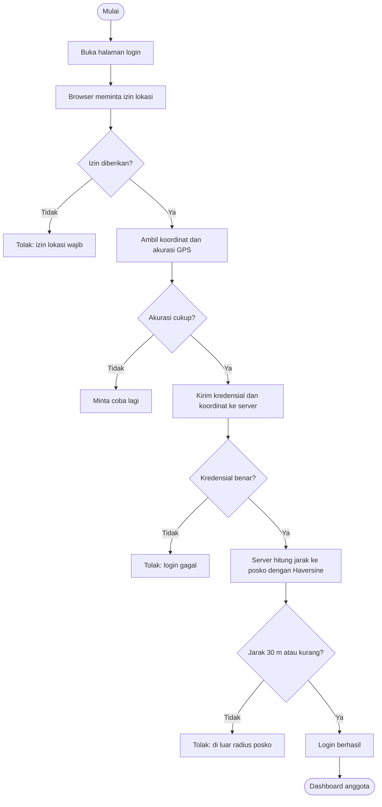
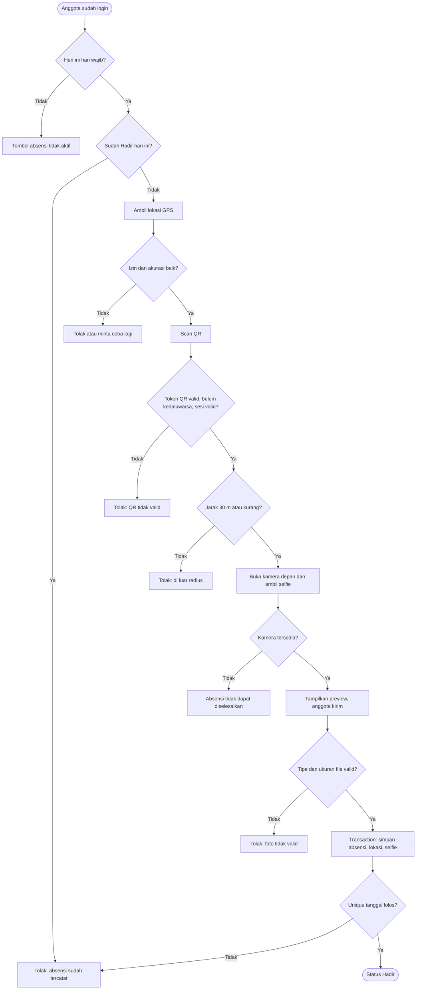
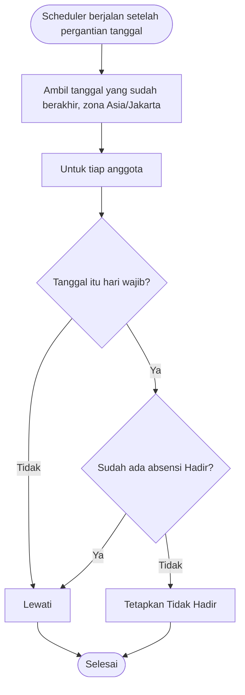

# PHASE 1 - SYSTEM ANALYSIS (SRS)

## KKN MANAGEMENT SYSTEM - Modul 1 Sistem Absensi

Terakhir diperbarui: 2026-11-06
Pembaruan 2026-11-06: dokumen ini sudah di-commit dan di-push (commit 9517b27). Phase 0 selesai, Phase 1 sedang berjalan. Teks "Untracked" atau "belum di-commit" di bagian bawah mencerminkan kondisi saat bagian itu ditulis dan sudah usang.

## 1. Tujuan dan Ruang Lingkup

Menetapkan kebutuhan Modul 1 Sistem Absensi Digital KKN Kelompok 30 UNTARA sebelum desain dan coding. Semua isi diturunkan dari aturan bisnis yang disetujui pemilik proyek. Tidak ada aturan baru. KARAKSA WASTE adalah aplikasi terpisah dan tidak termasuk.

## 2. Ringkasan Business Rules

| Kode  | Aturan                                                                                                                         |
| ----- | ------------------------------------------------------------------------------------------------------------------------------ |
| BR-01 | Dua role: Administrator dan Anggota. Otorisasi ditegakkan di backend.                                                          |
| BR-02 | Administrator tidak melakukan absensi. Hanya 18 anggota KKN yang absen.                                                        |
| BR-03 | Akun anggota hanya dibuat admin. Tidak ada pendaftaran mandiri. Total 19 akun (1 admin, 18 anggota).                           |
| BR-04 | Anggota login hanya dalam radius 30 m dari posko (Haversine di backend). Admin bebas geofence.                                 |
| BR-05 | GPS dan izin lokasi wajib. Jika tidak tersedia, proses ditolak. Akurasi buruk: diminta coba lagi.                              |
| BR-06 | Koordinat posko disimpan di pengaturan database. Belum diberikan, tidak boleh dikarang.                                        |
| BR-07 | Kategori Stay dan Shift Malam wajib Senin-Minggu. Weekend wajib Sabtu-Minggu. Kategori hanya menentukan hari wajib, bukan jam. |
| BR-08 | Hari tidak wajib tidak dihitung Tidak Hadir.                                                                                   |
| BR-09 | Zona waktu Asia/Jakarta. Absensi tersedia 00.00-23.59 WIB.                                                                     |
| BR-10 | Satu absensi berhasil per anggota per tanggal (unique constraint).                                                             |
| BR-11 | Status hanya Hadir, Menunggu, Tidak Hadir. Tidak ada Terlambat dan tidak ada absensi pagi/sore.                                |
| BR-12 | Tidak Hadir ditetapkan otomatis oleh Laravel Scheduler setelah hari berakhir, bukan saat dashboard dibuka.                     |
| BR-13 | QR dibuat admin, token acak, punya masa berlaku, terikat sesi valid, diverifikasi server, tidak bisa dipakai ulang.            |
| BR-14 | Selfie wajib dari kamera langsung dengan preview, disimpan di storage privat. Tidak ada klaim face recognition.                |
| BR-15 | Admin melihat semua data dan selfie. Anggota hanya miliknya.                                                                   |
| BR-16 | Laporan mengecualikan hari tidak wajib. Ekspor Excel dan PDF.                                                                  |
| BR-17 | NIM dan nomor HP tidak dipakai (aturan proyek).                                                                                |

## 3. Aktor dan Hak Akses

| Aktor              | Jumlah   | Keterangan                                           |
| ------------------ | -------- | ---------------------------------------------------- |
| Administrator      | 1 akun   | Mengelola sistem. Tidak absen. Login dari mana saja. |
| Anggota            | 18 akun  | Satu-satunya yang absen. Login dalam radius posko.   |
| Sistem (Scheduler) | otomatis | Menetapkan Tidak Hadir setelah hari berakhir.        |

Catatan: jika Rahel juga anggota KKN, ia memakai dua akun terpisah (Administrator dan Anggota).

| Fungsi                                                   | Administrator | Anggota                  |
| -------------------------------------------------------- | ------------- | ------------------------ |
| Login                                                    | Di mana saja  | Hanya dalam radius posko |
| Kelola akun anggota, kategori, reset password            | Ya            | Tidak                    |
| Ganti password sendiri                                   | Ya            | Ya                       |
| Pengaturan posko, QR, sistem                             | Ya            | Tidak                    |
| Absensi (QR dan selfie)                                  | Tidak         | Ya, di hari wajib        |
| Lihat profil, jadwal, statistik, riwayat, selfie sendiri | Tidak berlaku | Ya                       |
| Lihat data, lokasi, selfie semua anggota                 | Ya            | Tidak                    |
| Laporan dan ekspor                                       | Ya            | Tidak                    |

## 4. Functional Requirements

| Kode  | Kebutuhan                                                                                  |
| ----- | ------------------------------------------------------------------------------------------ |
| FR-01 | Admin membuat akun anggota (nama, identitas login, password awal, kategori).               |
| FR-02 | Tidak ada pendaftaran mandiri.                                                             |
| FR-03 | Admin mengubah data akun dan kategori anggota.                                             |
| FR-04 | Admin mereset password anggota.                                                            |
| FR-05 | Admin dan anggota dapat mengganti password sendiri.                                        |
| FR-06 | Pengguna dapat login dan logout.                                                           |
| FR-07 | Halaman admin hanya untuk Administrator, halaman anggota hanya untuk Anggota (backend).    |
| FR-08 | Anggota hanya dapat mengakses data miliknya.                                               |
| FR-09 | Anggota hanya dapat login dalam radius 30 m dari posko (Haversine, backend).               |
| FR-10 | Jarak divalidasi lagi saat absensi dan saat QR diproses.                                   |
| FR-11 | GPS mati atau izin ditolak: proses ditolak.                                                |
| FR-12 | Akurasi GPS buruk: anggota diminta mencoba lagi.                                           |
| FR-13 | Administrator bebas geofence.                                                              |
| FR-14 | Admin mengatur koordinat posko dan radius (disimpan di database).                          |
| FR-15 | Tersedia tiga kategori: Stay, Shift Malam, Weekend.                                        |
| FR-16 | Stay dan Shift Malam wajib Senin-Minggu. Weekend wajib Sabtu-Minggu.                       |
| FR-17 | Kategori hanya menentukan hari wajib, bukan jam.                                           |
| FR-18 | Hari tidak wajib tidak dihitung Tidak Hadir.                                               |
| FR-19 | Admin membuat QR dengan token acak sulit ditebak.                                          |
| FR-20 | QR punya masa berlaku dan terikat sesi absensi valid.                                      |
| FR-21 | Server memverifikasi token, masa berlaku, dan lokasi anggota.                              |
| FR-22 | QR tidak dapat dipakai ulang untuk absensi ganda.                                          |
| FR-23 | Absensi mewajibkan selfie kamera langsung (kamera depan diutamakan) dengan preview.        |
| FR-24 | Jika kamera atau izin tidak tersedia, absensi tidak dapat diselesaikan.                    |
| FR-25 | Server memvalidasi tipe dan ukuran file selfie.                                            |
| FR-26 | Selfie di storage privat. Admin melihat semua, anggota hanya miliknya.                     |
| FR-27 | Anggota dapat absen pukul 00.00-23.59 WIB, hanya pada hari wajib.                          |
| FR-28 | Satu absensi berhasil per anggota per tanggal (unique constraint).                         |
| FR-29 | Status hanya Hadir, Menunggu, Tidak Hadir.                                                 |
| FR-30 | Hari wajib yang masih berjalan dan belum hadir berstatus Menunggu.                         |
| FR-31 | Scheduler menetapkan Tidak Hadir otomatis setelah hari wajib berakhir.                     |
| FR-32 | Semua perhitungan tanggal memakai Asia/Jakarta.                                            |
| FR-33 | Absensi menyimpan lokasi dan waktu.                                                        |
| FR-34 | Dashboard admin: statistik ringkas kehadiran.                                              |
| FR-35 | Dashboard admin: daftar anggota dan kategori.                                              |
| FR-36 | Riwayat absensi dengan filter tanggal, nama, kategori, status.                             |
| FR-37 | Detail absensi: lokasi, selfie, QR.                                                        |
| FR-38 | Halaman pengaturan (posko, radius, sistem).                                                |
| FR-39 | Dashboard anggota: profil dan kategori.                                                    |
| FR-40 | Status hari ini dan informasi hari wajib.                                                  |
| FR-41 | Tombol absensi.                                                                            |
| FR-42 | Riwayat, selfie, dan statistik pribadi.                                                    |
| FR-43 | Laporan harian, mingguan, bulanan, per anggota, per kategori, rentang tanggal.             |
| FR-44 | Laporan memuat hari wajib, Hadir, Tidak Hadir, persentase (hari tidak wajib dikecualikan). |
| FR-45 | Ekspor Excel dan PDF.                                                                      |
| FR-46 | Aktivitas penting admin dicatat (activity log).                                            |

## 5. Non-Functional Requirements

| Kode   | Kebutuhan                                                                                               |
| ------ | ------------------------------------------------------------------------------------------------------- |
| NFR-01 | Password di-hash.                                                                                       |
| NFR-02 | Semua form dilindungi CSRF.                                                                             |
| NFR-03 | Semua input divalidasi di backend.                                                                      |
| NFR-04 | Otorisasi di backend lewat middleware role.                                                             |
| NFR-05 | Rate limiting pada login, absensi, dan pemrosesan QR.                                                   |
| NFR-06 | Token QR acak dan diverifikasi server.                                                                  |
| NFR-07 | Absensi ganda dicegah di database dan aplikasi.                                                         |
| NFR-08 | Selfie divalidasi, disimpan privat, diakses lewat route yang memeriksa hak akses.                       |
| NFR-09 | Proses absensi memakai database transaction.                                                            |
| NFR-10 | Rahasia hanya di .env, tidak masuk Git.                                                                 |
| NFR-11 | HTTPS wajib saat deployment.                                                                            |
| NFR-12 | Activity log untuk tindakan admin.                                                                      |
| NFR-13 | Tidak mengklaim face recognition. Keterbatasan GPS spoofing dijelaskan, mitigasi yang wajar diterapkan. |
| NFR-14 | Responsif, mobile-first.                                                                                |
| NFR-15 | Dapat dibuka di browser Android dan iOS tanpa instal aplikasi.                                          |
| NFR-16 | Halaman absensi mudah dipakai satu tangan di smartphone.                                                |
| NFR-17 | Pesan error berbahasa Indonesia yang jelas.                                                             |
| NFR-18 | Pilihan frontend belum ditentukan (diputuskan di Phase 2).                                              |
| NFR-19 | Melayani 19 akun. Skala kecil.                                                                          |
| NFR-20 | (Usulan) Halaman terbuka dalam waktu wajar di koneksi seluler biasa. Angka belum ditetapkan.            |
| NFR-21 | Riwayat dan laporan memakai pagination.                                                                 |
| NFR-22 | (Usulan) Ukuran selfie dibatasi. Batas ditetapkan di Phase 2.                                           |
| NFR-23 | Scheduler berjalan harian via Cron di server.                                                           |
| NFR-24 | Jika Scheduler terlewat, sistem menyusul menetapkan Tidak Hadir untuk hari yang sudah berakhir.         |
| NFR-25 | Zona waktu Asia/Jakarta konsisten.                                                                      |
| NFR-26 | Backup berkala database dan file selfie.                                                                |
| NFR-27 | Data anggota dan selfie tidak ada di repository PUBLIC.                                                 |
| NFR-28 | Perubahan struktur database lewat migration.                                                            |
| NFR-29 | Laravel MVC, modular, tanpa overengineering.                                                            |
| NFR-30 | KARAKSA WASTE terpisah.                                                                                 |
| NFR-31 | Kompatibilitas package dengan Laravel 13 dan PHP 8.5 diperiksa sebelum dipasang.                        |
| NFR-32 | Dokumentasi diperbarui sesuai kondisi aktual.                                                           |
| NFR-33 | (Usulan) Browser modern Android/iOS dan laptop. Kamera dan GPS di browser memerlukan HTTPS.             |

## 6. Use Case

| Kode  | Use case                                         | Aktor          | Terkait FR                       |
| ----- | ------------------------------------------------ | -------------- | -------------------------------- |
| UC-01 | Login admin (tanpa geofence)                     | Administrator  | FR-06, FR-13                     |
| UC-02 | Login anggota (dengan geofence)                  | Anggota        | FR-06, FR-09 sampai FR-12        |
| UC-03 | Logout                                           | Admin, Anggota | FR-06                            |
| UC-04 | Ganti password sendiri                           | Admin, Anggota | FR-05                            |
| UC-05 | Kelola akun anggota                              | Administrator  | FR-01 sampai FR-04               |
| UC-06 | Ubah kategori jadwal anggota                     | Administrator  | FR-03, FR-15 sampai FR-18        |
| UC-07 | Atur koordinat posko dan radius                  | Administrator  | FR-14                            |
| UC-08 | Buat QR absensi                                  | Administrator  | FR-19, FR-20                     |
| UC-09 | Absensi (geofence, QR, selfie)                   | Anggota        | FR-10, FR-21 sampai FR-28, FR-33 |
| UC-10 | Lihat status, riwayat, statistik, selfie pribadi | Anggota        | FR-39 sampai FR-42               |
| UC-11 | Pantau absensi semua anggota                     | Administrator  | FR-34 sampai FR-37               |
| UC-12 | Laporan dan ekspor Excel/PDF                     | Administrator  | FR-43 sampai FR-45               |
| UC-13 | Tetapkan Tidak Hadir otomatis                    | Sistem         | FR-29 sampai FR-32               |
| UC-14 | Catat activity log admin                         | Sistem         | FR-46                            |

## 7. Diagram Alur

### 7.1 Login anggota (dengan geofence)

Login admin sama, tanpa langkah izin lokasi dan jarak.

### 7.2 Absensi anggota

Urutan scan QR lalu selfie adalah usulan. Urutan final dikunci di Phase 2.

### 7.3 Penetapan Tidak Hadir otomatis

## 8. Keputusan Terbuka (dibawa ke Phase 2 dan seterusnya)

- Koordinat posko: belum ada, diminta di Phase 5. Tidak dikarang.
- Durasi kedaluwarsa QR: belum diputuskan. Rekomendasi dan persetujuan sebelum implementasi (Phase 7).
- Arti "sesi absensi" (FR-20): QR per hari atau dibuat kapan saja oleh admin. Dibahas di Phase 2.
- Identitas login (FR-01): email atau username. Dibahas di Phase 2.
- Urutan langkah absensi (QR lalu selfie) dan batas ukuran selfie: dikunci di Phase 2.
- Pilihan frontend: Phase 2.
- Cara uji kamera dan GPS di smartphone saat pengembangan (butuh HTTPS atau localhost): Phase 2.

## 9. Status Phase 1

- Bagian 1 sampai 5 (aktor, FR, NFR, use case, diagram, ringkasan business rules): Dibuat.
- Menunggu persetujuan pemilik proyek sebelum Phase 2 (System Design). Tidak ada coding sebelum analisis dan desain disetujui.
